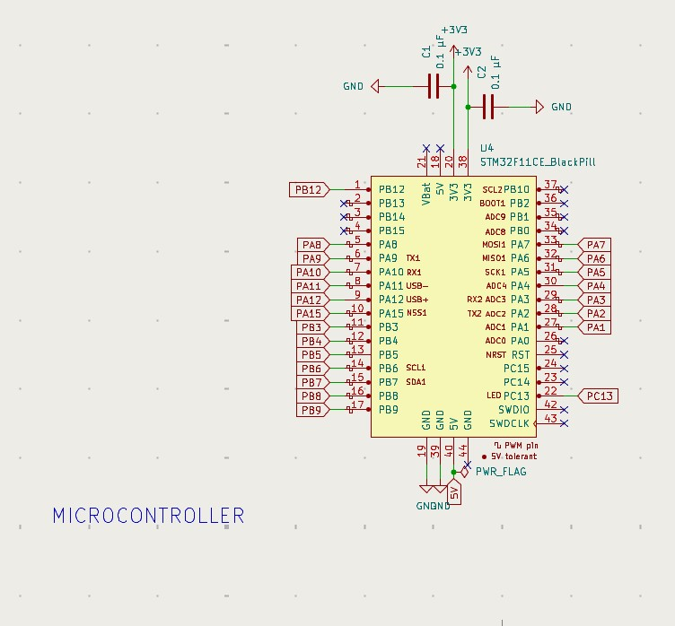
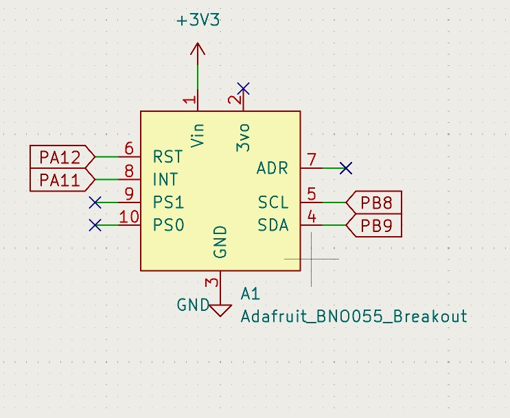
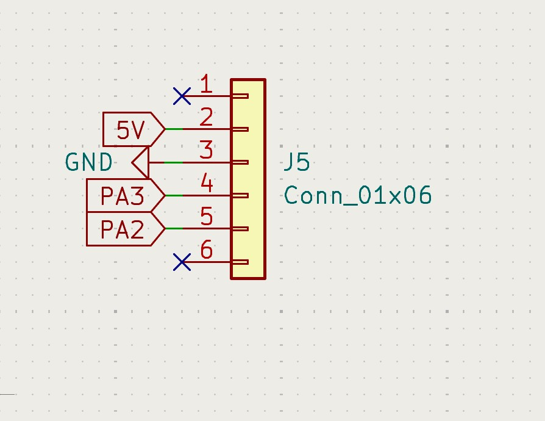
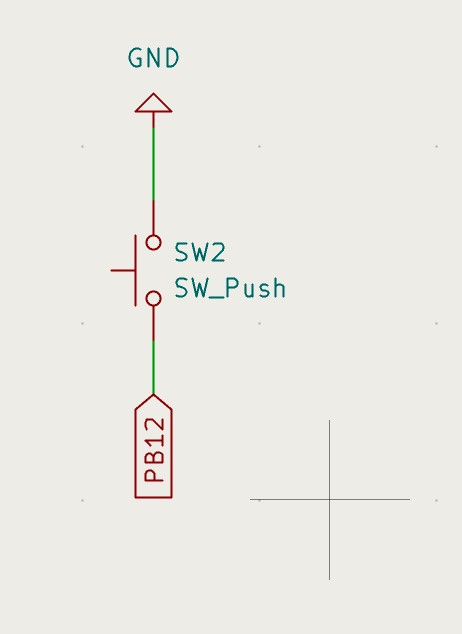
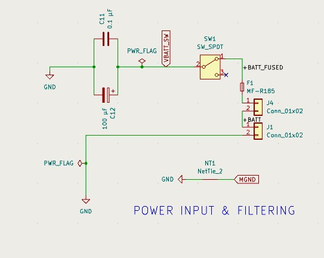
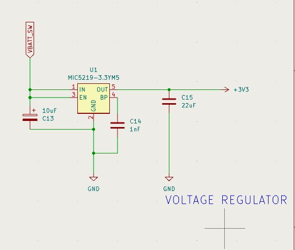
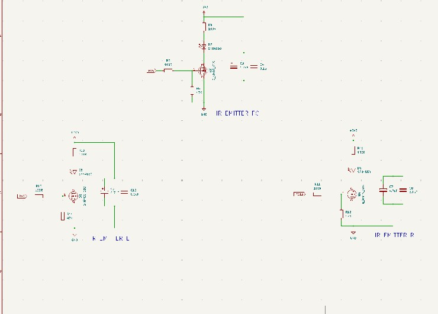
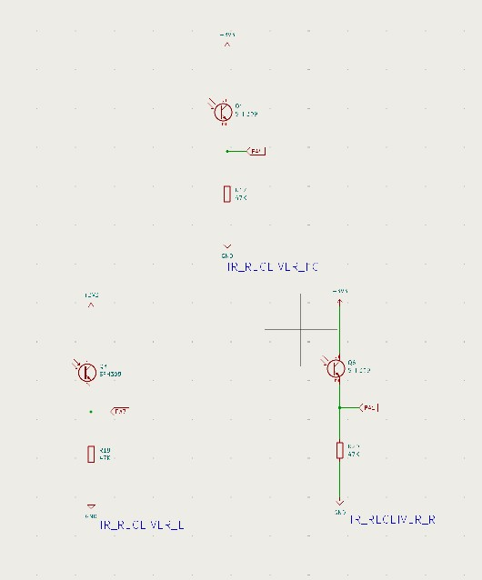
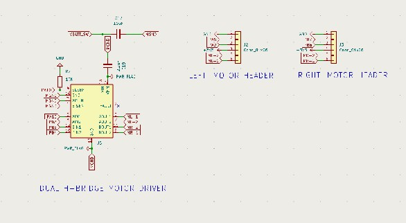

# Micromouse 2026

A team Micromouse project: a maze-solving robot whose solver is written in C. The solver is developed and tested in the [Micromouse Simulator (mms)](https://github.com/mackorone/mms) and will later run on a physical mouse in a 10×10 maze. The simulator uses a 16×16 maze.

> [!NOTE]
> **Work in progress.** The code is still being developed, so this README describes what the solver is *designed* to do rather than its exact current state. Details may change as the project evolves.

---

## Table of Contents

- [Goal](#goal)
- [Planned Approach](#planned-approach)
- [Configuration](#configuration)
- [Project Structure](#project-structure)
- [Running in the Simulator](#running-in-the-simulator)
- [Simulator Setup (Windows)](#simulator-setup-windows)
  - [Install the C compiler (MinGW)](#install-the-c-compiler-mingw)
  - [Install the simulator](#install-the-simulator)
  - [Connect this repo to the simulator](#connect-this-repo-to-the-simulator)
- [Hardware](#hardware)
- [Circuit Diagrams](#circuit-diagrams)
- [KiCad PCB Design](#kicad-pcb-design)
- [Team](#team)
- [Acknowledgements](#acknowledgements)

---

## Goal

The aim is the best possible mms score, not just reaching the center. The score (lower is better) is:
The aim is the best mms score, not just reaching the center. The official score (lower is better) is:

```
score = best run turns + best run effective distance + 0.1 × (total turns + total effective distance)
```

"Effective distance" equals normal distance when the mouse moves one cell at a time. See the [Scorekeeping section of the mms README](https://github.com/mackorone/mms/blob/main/README.md#scorekeeping) for the full definition.

This has two implications:

1. **Turns cost as much as forward moves.** The best path is the one with the fewest actions, not just the fewest cells.
2. **Exploration counts at a tenth of the final run.** Exploring is only worth it when it shortens the final run.

---

## Planned Approach

Instead of a classic flood fill, the solver is designed to use a shortest-path search over position **and** heading, so the cost of turns is priced in. The run is split into three phases:

| Phase | What it does |
| --- | --- |
| **Explore** | Plans a route to the center treating unknown walls as open, drives out to check the uncertain parts of that route, then re-plans. Stops once the best route is confirmed, rather than mapping the whole maze. |
| **Return** | Heads back to the start on a path that also sets the mouse up well for the final run. |
| **Final run** | Runs the best known route from the start to the center. |

---

## Configuration

The solver has two tunable settings (the `#define`s at the top of `MMS_Code/solver.c`):

| Setting | Description |
| --- | --- |
| **Maze size** | 16×16 for the simulator, 10×10 for the real maze. Read from the API at startup (the arrays are sized for up to 16×16). The goal is the center, so it moves with the size. |
| **Exploration budget** | The most actions (turns plus cells driven) the mouse may spend exploring and driving home. It stands in for the 10-minute limit on the real maze. The mouse always keeps enough in reserve to get back to the start. |

---

## Project Structure

| File | Description |
| --- | --- |
| `MMS_Code/API.h` | The only boundary between the solver and the outside world: sensing, movement and debug display calls. |
| `MMS_Code/API.c` | Simulator version of the API: sends mms commands on stdout and reads replies from stdin. Swapped for a hardware version on the real mouse. |
| `MMS_Code/main.c` | Entry point and main loop, including reset-button handling. |
| `MMS_Code/solver.h` | Public interface of the solver. |
| `MMS_Code/solver.c` | Mapping, exploration, path planning (Dijkstra over position and heading) and the simulator debug display. Also includes a simple left-wall follower as a reference example (unused by default). |
| `tests/` | Offline test harness (not part of the mms build): fake simulator, test mazes and `run_tests.sh`. See [`tests/README.md`](tests/README.md). |
| `docs/schematics/` | Schematic images shown in the Circuit Diagrams section. |
| `README.md` | This file. |

<!-- TODO: update this list as files change. -->

---

## Simulator Setup (Windows)

This guide gets the solver building and running in mms on Windows. For everything else about the simulator, see the [mms README](https://github.com/mackorone/mms/blob/main/README.md).

### Install the C compiler (MinGW)

MinGW provides `gcc`, the standard C compiler, on Windows.

<!-- TODO: add the MinGW installer download link. -->

### Connect this repo to the simulator

1. Clone or download this repo to a folder **outside** the mms folder, then open its `MMS_Code` folder and copy that folder's path (use **Copy address as text** in File Explorer).
2. In mms, click the **+** button next to the **Mouse** dropdown.
3. Fill in the fields:

   | Field | Value |
   | --- | --- |
   | **Name** | Anything, e.g. `Micromouse_2026` |
   | **Directory** | The path to the `MMS_Code` folder inside this repo, e.g. `C:\path\to\Micromouse_2026\MMS_Code` |
   | **Build Command** | `gcc -o a.exe API.c main.c solver.c` |
   | **Run Command** | The `MMS_Code` folder path followed by `\a.exe`, e.g. `C:\path\to\Micromouse_2026\MMS_Code\a.exe` |

4. Click **Build**. The box next to it should turn green and say `COMPLETE`.
5. Pick a maze from the **Maze** dropdown and click **Run**. The score appears on the **Stats** tab after the run.

### Tips

- The simulator API (wall checks, movement) is documented in the [mms Mouse API](https://github.com/mackorone/mms#mouse-api). When the code moves to the real mouse, these API calls get replaced with functions that read the IR sensors and drive the motors.
- The **Reset** button isn't supported by this code. Click **Cancel** to restart a run instead.
- Custom mazes can be written as text files. See the [Maze Files section of the mms README](https://github.com/mackorone/mms#maze-files). For ready-made mazes, see [micromouseonline/mazefiles](https://github.com/micromouseonline/mazefiles).
- macOS and Linux setup steps: coming soon.

<!-- TODO: add our own example mazes (coming soon) and link them in the maze tip above. -->
<!-- TODO: add macOS and Linux setup steps. -->

---

## Hardware

| Part | Choice |
| --- | --- |
| Microcontroller | STM32 Black Pill board (schematic part `STM32F11CE_BlackPill`) |
| Motors / encoders | Dual H-bridge motor driver with left and right motor headers (see schematic); motors and encoders TBD |
| IMU | Adafruit BNO055 breakout |
| Wall sensors | Infrared emitters and phototransistor receivers: front center, left and right |
| Power | Battery, fuse and power switch feeding a MIC5219-3.3 voltage regulator (3.3 V) |

**Build and flash steps:** TBD

Links Section for Parts when Found.
<!-- TODO: each part will be linked here once a specific part is chosen. Still to confirm: exact STM32 board and part number, motor driver part, motors, encoders and the IR emitter and receiver parts. -->

---

## Circuit Diagrams

<table>
  <tr>
    <td width="50%" align="center">
      
      <br>
      <b>Voltage Regulator</b>
    </td>
    <td width="50%" align="center">
      
      <br>
      <b>Power Input and Filtering</b>
    </td>
  </tr>
  <tr>
    <td width="50%" align="center">
      
      <br>
      <b>IR Emitter (Left)</b>
    </td>
    <td width="50%" align="center">
      
      <br>
      <b>IR Receiver (Left)</b>
    </td>
  </tr>
  <tr>
    <td width="50%" align="center">
      
      <br>
      <b>Microcontroller (Black Pill)</b>
    </td>
    <td width="50%" align="center">
      
      <br>
      <b>IMU (BNO055 Breakout)</b>
    </td>
  </tr>
  <tr>
    <td width="50%" align="center">
      
      <br>
      <b>6-Pin Connector (J5)</b>
    </td>
    <td width="50%" align="center">
      
      <br>
      <b>Push Button (SW2)</b>
    </td>
  </tr>
  <tr>
    <td width="50%" align="center">
      
      <br>
      <b>Power Input and Filtering (Battery, Fuse and Switch)</b>
    </td>
    <td width="50%" align="center">
      
      <br>
      <b>Voltage Regulator (MIC5219-3.3)</b>
    </td>
  </tr>
  <tr>
    <td width="50%" align="center">
      
      <br>
      <b>IR Emitters (Front Center, Left, Right)</b>
    </td>
    <td width="50%" align="center">
      
      <br>
      <b>IR Receivers (Front Center, Left, Right)</b>
    </td>
  </tr>
  <tr>
    <td width="50%" align="center">
      
      <br>
      <b>Dual H-Bridge Motor Driver and Motor Headers</b>
    </td>
    <td width="50%"></td>
  </tr>
</table>

More will be added as schematics are found.
<!-- TODO: more schematics will be added as they are found for each part. To add one, copy a <td> cell, then swap the image link, the alt text and the bold caption. Start a new <tr> row after every two cells. -->

---

## KiCad PCB Design

**Once PCB design is finish picture and explanation will be added here**

<!-- TODO: once the design is done, add a picture of the board layout and an explanation of the board. -->

---

## Team

| Name | Role |
| --- | --- |
| Daniel | Team Captain |
| Rafael | TBD |
| Marisol | TBD |
| Griselda | TBD |
| Connor | TBD |

<!-- TODO: once roles are set, each team member should fill in their role and a short description of what they worked on. -->

---

## Acknowledgements

This project is developed and tested with [mms](https://github.com/mackorone/mms), the Micromouse Simulator by mackorone.
